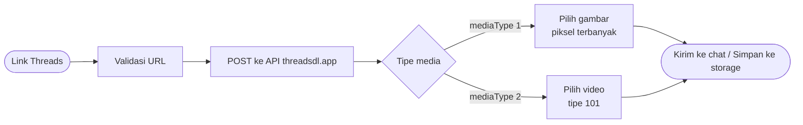

<div align="center">


<a href="https://github.com/kyuuXzry/THREADS-DOWNLOADER">
  
</a>

<br/>

<a href="https://github.com/kyuuXzry/THREADS-DOWNLOADER/stargazers">
  
</a>
<a href="https://github.com/kyuuXzry/THREADS-DOWNLOADER/network/members">
  
</a>
<a href="https://github.com/kyuuXzry/THREADS-DOWNLOADER/issues">
  
</a>
<a href="https://github.com/kyuuXzry/THREADS-DOWNLOADER/commits">
  
</a>

<br/>


<a href="https://github.com/WhiskeySockets/Baileys">
  
</a>


<br/>


</div>

<br/>

<div align="center">

<h2>&nbsp;Ringkasan</h2>

</div>

Repositori ini menyediakan scraper performa tinggi untuk **Threads** dalam dua implementasi:

<table align="center" width="100%">
<tr>
<td width="50%" valign="top" align="center">


**Plugin Bot WhatsApp**

Memakai library Baileys. Kirim link Threads ke bot, media langsung dikirim balik ke chat.

<sub><code>plugins/threads.js</code></sub>

</td>
<td width="50%" valign="top" align="center">


**Script CLI**

Dioptimalkan untuk Termux. Media diunduh ke penyimpanan Android lalu dibuka otomatis.

<sub><code>threads-cli.js</code></sub>

</td>
</tr>
</table>

Keduanya mendeteksi jenis media secara otomatis, mengambil gambar dengan resolusi tertinggi, mendapatkan video dengan kualitas asli, dan melewati watermark.

<br/>

<div align="center">


<h2>&nbsp;Fitur Utama</h2>

</div>

<table align="center" width="100%">
<tr>
<td width="33%" valign="top" align="center">


**Deteksi Media Otomatis**

Membedakan gambar (`mediaType 1`) dan video (`mediaType 2`).

</td>
<td width="33%" valign="top" align="center">


**Resolusi Tertinggi**

Memilih gambar dengan jumlah piksel terbanyak (`lebar × tinggi`).

</td>
<td width="33%" valign="top" align="center">


**Video Kualitas Asli**

Mengambil URL video bertipe `101` untuk kualitas terbaik yang tersedia.

</td>
</tr>
<tr>
<td width="33%" valign="top" align="center">


**Bebas Watermark**

Media diambil langsung dari sumbernya tanpa watermark tambahan.

</td>
<td width="33%" valign="top" align="center">


**Metadata Lengkap**

Mengekstrak username penulis dan caption postingan secara akurat.

</td>
<td width="33%" valign="top" align="center">


**Unduh Otomatis (CLI)**

Simpan ke penyimpanan Android dan buka lewat `termux-open`.

</td>
</tr>
</table>

<br/>

<div align="center">


<h2>&nbsp;Cara Kerja</h2>

</div>



<br/>

<div align="center">


<h2>&nbsp;Prasyarat</h2>

</div>

```bash
$ node -v
v18.17.0   # versi minimum yang dibutuhkan

$ npm install axios
```

<br/>

<div align="center">


<h2>&nbsp;Instalasi &amp; Penggunaan</h2>

</div>

### &nbsp;A. Bot WhatsApp (Baileys)

1. Salin file `threads.js` ke direktori `plugins/` bot Anda.
2. Pastikan file utama bot (misalnya `main.js`) mengirim parameter `m, { conn, text, command, usedPrefix }` ke plugin.
3. Restart bot Anda.
4. Gunakan perintahnya:

```text
.threads https://www.threads.net/@user/post/xxxx
```

> Alias yang tersedia: `.threads`, `.threadsdl`, `.threadsdownloader`

### &nbsp;B. CLI (Termux / Terminal)

1. Unduh file `threads-cli.js`.
2. *(Opsional)* Untuk fitur buka otomatis, pasang Termux API: `pkg install termux-api` dan aplikasi **Termux:API**.
3. Aktifkan izin penyimpanan di Termux: `termux-setup-storage`.
4. Jalankan:

```bash
node threads-cli.js
```

5. Tempel URL Threads saat diminta.

File hasil unduhan disimpan di `/storage/emulated/0/jsom`.

<details>
<summary><b>Contoh tampilan CLI</b></summary>

```text
============================================================
  THREADS DOWNLOADER - UNDUH & BUKA OTOMATIS
============================================================

[12:00:01] [INFO] Target URL: https://www.threads.net/@user/post/xxxx
[12:00:01] [PROSES] Menghubungi API ThreadsDL...
------------------------------------------------------------
  METADATA POSTINGAN
------------------------------------------------------------
  Username : @user
  Caption  : "Contoh caption postingan"
------------------------------------------------------------

[ Media 1 ]
  Tipe     : Video (MP4)
  Kualitas : Asli / HD
[12:00:03] [SELESAI] Tersimpan: threads_user_1700000000000_1.mp4
```

</details>

<br/>

<div align="center">


<h2>&nbsp;Konfigurasi Teknis (Plugin)</h2>

</div>

Plugin mengikuti arsitektur standar Baileys. Jika base bot Anda berbeda, sesuaikan parameter dan pemanggilan fungsinya.

| Parameter | Tipe Data | Deskripsi |
| :-- | :-- | :-- |
| `m` | `Object` | Objek pesan masuk dari Baileys. |
| `conn` | `Object` | Objek koneksi socket Baileys. |
| `text` | `String` | URL setelah command. |
| `command` | `String` | Nama command yang dipanggil. |
| `usedPrefix` | `String` | Prefix command (contoh: `.`). |

<br/>

<div align="center">


<h2>&nbsp;Struktur Repositori</h2>

</div>

```text
THREADS-DOWNLOADER
├── plugins
│   └── threads.js        # Plugin bot WhatsApp (Baileys)
├── threads-cli.js        # Script CLI untuk Termux / Terminal
└── README.md
```

<br/>

<div align="center">


<h2>&nbsp;Pemecahan Masalah</h2>

</div>

| Masalah | Solusi |
| :-- | :-- |
| `Link tidak valid` | Pastikan URL mengandung `threads.net` atau `threads.com`. |
| `Koneksi timeout` | Server API terlalu lama merespons. Coba lagi beberapa saat kemudian. |
| Gagal membuat folder (CLI) | Jalankan `termux-setup-storage` dan izinkan akses penyimpanan. |
| File tidak terbuka otomatis | Pasang `termux-api` dan aplikasi Termux:API. |
| Plugin tidak merespons | Cek apakah struktur parameter bot Anda sama dengan struktur standar Baileys. |

<br/>

<div align="center">


<h2>&nbsp;Kontak</h2>

<a href="https://wa.me/628567126744">
  
</a>
<a href="https://instagram.com/rissxzry_">
  
</a>
<a href="https://github.com/kyuuXzry">
  
</a>

<br/><br/>

<sub>Jika repositori ini bermanfaat, berikan <b>bintang</b> sebagai dukungan.</sub>

<br/><br/>

<a href="https://github.com/kyuuXzry/THREADS-DOWNLOADER/stargazers">
  
</a>

<br/><br/>


</div>
